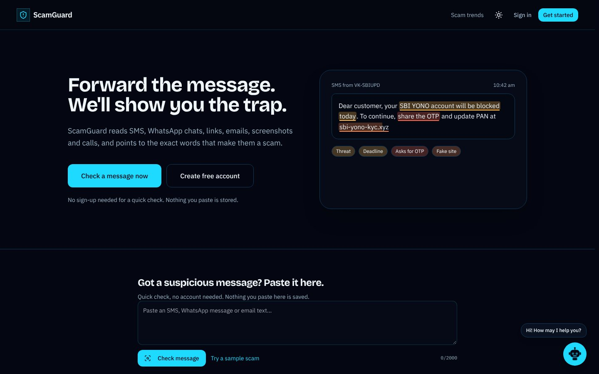
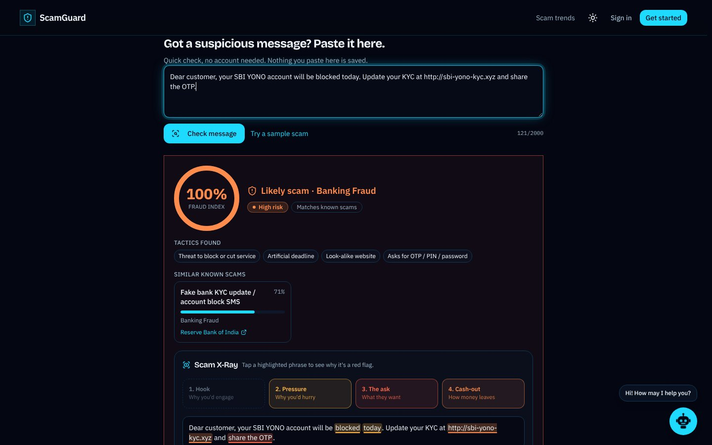
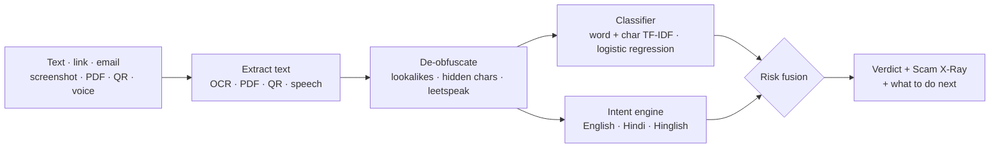

<div align="center">

# 🛡️ ScamGuard

### AI-powered scam detection for India, with a reason behind every verdict

Paste an SMS, WhatsApp message, email, link, screenshot, PDF, QR code or call recording.
ScamGuard says whether it is a scam, shows *why*, and tells you exactly what to do next.

[](https://scamguard-frontend-r6t7.onrender.com)
[](backend/ml_training/research/results_v2.md)
[](backend/ml_training/research/results_v2.md)
[](#-engineering)

[](https://github.com/priyamthakur275/ScamGuard-AI/actions/workflows/backend-ci.yml)
[](https://github.com/priyamthakur275/ScamGuard-AI/actions/workflows/frontend-ci.yml)
[](https://github.com/priyamthakur275/ScamGuard-AI/actions/workflows/ml-ci.yml)
[](LICENSE)


**[Open the live site →](https://scamguard-frontend-r6t7.onrender.com)** &nbsp;·&nbsp; no sign-up needed for the quick check, or press **Try the demo account**

</div>

<p align="center">
  
  
</p>

---

## ✨ Highlights

- **97.5% F1 on 1,874 real Indian messages** from scam campaigns the model never saw in training (95% CI 96.8–98.0, ROC-AUC 0.994).
- **Leak-free evaluation.** Messages are grouped into scam campaigns with MinHash, and whole campaigns go to train or test. A random split would have leaked 793 near-duplicate test messages into training.
- **Built to resist evasion.** Lookalike letters, hidden characters, `cl1ck`, spaced-out words and `hxxp://` links are undone before scoring. Under a combined attack, recall stays at **97.2%** (the earlier version dropped to 88.4%).
- **Explains itself.** Scam X-Ray highlights the trap phrases; TrustLens shows the model score next to the evidence for and against.
- **Helps after the fact.** Golden Hour guides people who already paid: call 1930, report on cybercrime.gov.in and Chakshu, with a ready-made complaint.
- **Honest research.** Found and fixed a train/serve mismatch in its own production pipeline, built a real Hindi test set, and showed that a fine-tuned **XLM-R lifts real-Hindi F1 from 64.7 to 84.5** (three seeds).
- **Production engineering.** FastAPI + Next.js, JWT auth with refresh rotation, rate limits, SSRF-safe link analysis, 885 automated tests, CI on every push, and a reproducible results pipeline.

## 🧭 How it works



The classifier gives a probability; the intent engine adds evidence for scam intents (asks for an OTP, fee to receive
money, arrest threat, new-number emergency …) and subtracts protective signals ("never share your OTP", official
helplines). Scores between 0.3 and 0.7 are shown as **"Not sure: check before you act"**: that band holds 3.6% of
messages but a third of all errors.

## 📊 Results

**Main test set**: 1,874 real messages, campaign-held-out.

| Accuracy | Precision | Recall | F1 (95% CI) | False alarms | ROC-AUC |
|:---:|:---:|:---:|:---:|:---:|:---:|
| **96.7%** | **97.8%** | **97.1%** | **97.5%** (96.8–98.0) | **3.9%** | **0.994** |

**Robustness and research findings**

| Experiment | Result |
|---|---|
| Combined evasion attack (lookalikes, zero-width, leetspeak, defanged links): scams caught | 88.4% → **97.2%** |
| Scams with **no link** (a "has a link" rule catches 0%) | **95.8%** caught |
| Real Hindi messages (77 reports labelled before scoring): TF-IDF vs fine-tuned **XLM-R** | 64.7 → **84.5 ± 4.2** F1 (3 seeds) |
| Cross-domain: trained on UK SMS, tested on Indian SMS (TF-IDF vs **MuRIL**) | 67.8 → **95.4** F1 (3 seeds) |
| Same, after adding 10% Indian data to the TF-IDF model | 96.4 F1 |
| Calibration error (ECE) · latency | 0.017 · 0.67 ms per message on CPU |

Every number comes from one script: `python -m ml_training.research.v2_experiments` (from `backend/`, about 40 s).
Full tables: [results_v2.md](backend/ml_training/research/results_v2.md) ·
[transformer_results.md](backend/ml_training/research/transformer_results.md) ·
[model card](docs/v2/MODEL_CARD.md) · [v2 summary](docs/v2/V2_SUMMARY.md).

<p align="center"></p>

## 🧰 Features

| | |
|---|---|
| **Check** | Quick check without an account · Investigate text, links, emails, screenshots (OCR), PDFs, QR codes and voice calls · Telegram bot · browser extension (Chrome, Edge, Brave) · installable PWA |
| **Explain** | Scam X-Ray (hook → pressure → ask → cash-out) · TrustLens evidence view · website trust score (domain age, HTTPS, redirects, credential forms) · Copilot grounded in the scan and known Indian scam patterns |
| **Act** | Golden Hour countdown for victims · one-tap reporting to 1930, cybercrime.gov.in and Chakshu · UPI "before you pay" check · QR payment check · payment-screenshot check |
| **Track** | Dashboard, history and analytics with PDF/CSV export · scam trends · flashcards |

## 🗂️ Dataset: ScamGuard-IN-2026

- **11,399 messages**: real reports from IMC'25 (CC BY 4.0) and India SMS (MIT), 2025–26 advisories, and clearly
  flagged synthetic rows (training only).
- **Audited labels**: 2,922 review decisions; about 1 in 5 reported "scams" turned out to be genuine messages.
- **4,085 campaigns** from 6,662 real messages, so the train/test split never shares a scam template.
- Personal data masked. Details in the [datasheet](backend/ml_training/datasets/scamguard_in_2026/DATASHEET.md).

## 🏗️ Tech stack

| Layer | Technology |
|---|---|
| Front end | Next.js 14, React, TypeScript, Tailwind CSS, PWA |
| Back end | FastAPI, SQLAlchemy, Alembic, PostgreSQL / SQLite, JWT with refresh rotation, rate limiting |
| ML | scikit-learn (TF-IDF + logistic regression), intent-based risk engine, ONNX Runtime path for XLM-R |
| Research | PyTorch + Hugging Face (MuRIL, XLM-R on Colab T4), Jupyter, Streamlit |
| Inputs | Tesseract OCR, PDF parsing, ZBar QR decoding, speech-to-text |
| Deployment | Render (auto-deploy from `main`), Docker Compose, GitHub Actions CI |

## 🔧 Engineering

- **885 automated tests**: 870 back end, 15 front end, plus type check and lint; three CI pipelines on every push.
- **Security**: bcrypt passwords, short-lived JWTs with refresh rotation, self-hosted CAPTCHA, per-route rate limits,
  server-side link fetching with SSRF protection, 8 MB upload cap.
- **Privacy**: quick checks and the Telegram bot never store messages; saved scans are visible only to their owner.
- **Reproducibility**: fixed seeds, pinned scikit-learn, and the paper's numbers are generated from the results files.

## 🚀 Run it locally

Needs **Python 3.10–3.14** and **Node.js 18+**. No database, `.env` file or Docker required.

```bash
python3 run.py          # macOS / Linux   (Windows: py run.py)
```

The first run installs everything (2–5 minutes) and opens http://localhost:3000 (API docs at
http://127.0.0.1:8000/docs). Full stack with PostgreSQL: `docker compose up --build`.
Troubleshooting: [docs/SETUP.md](docs/SETUP.md).

```bash
cd backend && python -m pytest -q                              # back-end tests
cd frontend && npm run typecheck && npm run lint && npm test   # front-end checks
```

## 📁 Repository

```
backend/
  app_service/     FastAPI app: routes, services, auth, database, Telegram webhook
  ml_common/       preprocessing (incl. de-obfuscation), features, model registry
  ml_service/      inference: classifier, risk engine, explainers, optional XLM-R path
  ml_training/     ScamGuard-IN-2026 dataset, training, experiments, results
  artifacts/       trained models
  tests/           back-end tests
frontend/          Next.js app
browser-extension/ Chrome / Edge / Brave extension
research/          cross-domain study (notebook + Streamlit) and transformer comparison (Colab)
docs/              report, slides, poster, papers, model card, setup guide
infra/             Dockerfiles and nginx config
run.py             one-command local run
```

## 📄 Documents

| | |
|---|---|
| Project report | [ScamGuard_Project_Report.pdf](docs/report/ScamGuard_Project_Report.pdf) |
| Conference paper (submitted to COMP-SIF 2027, under review) | [ScamGuard_Conference_Paper.pdf](docs/paper/ScamGuard_Conference_Paper.pdf) |
| v2 paper draft: evasion robustness, train/serve mismatch, real-Hindi gap | [main.pdf](docs/paper/v2/main.pdf) |
| Slides · poster | [presentation](docs/presentation/ScamGuard_Final_Presentation.pptx) · [A3 poster](docs/poster/ScamGuard_Poster_A3.pdf) |

## ⚖️ Limitations

Real Hindi is the hardest case: the live TF-IDF model scores 66.7% F1 there, and the XLM-R model that fixes it needs
a larger server than the free tier, so it ships switched off ([how to enable](backend/ml_service/inference/indic_model.py)).
The real-Hindi test set has 77 messages, and most Hindi training data is synthetic.

## 👥 Team

Major Project, Department of CSE, **B.M.S. College of Engineering, Bengaluru** (2026)

| | |
|---|---|
| Author | **Priyam Thakur** · [@priyamthakur275](https://github.com/priyamthakur275) |
| Team | Bhavya Goyal · Samir Chaudhary · Sana Subodh |
| Guide | Dr. Kayarvizhy N, Professor, Department of CSE |

## 📄 License & Security

Released under the [MIT License](LICENSE). See [SECURITY.md](SECURITY.md) for security architecture and vulnerability reporting.
