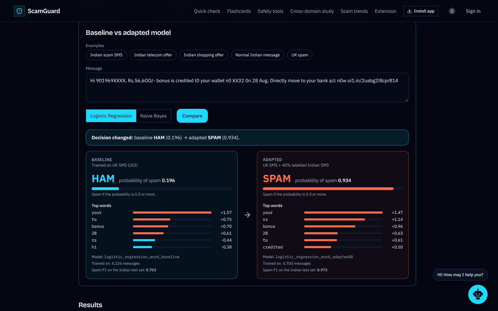
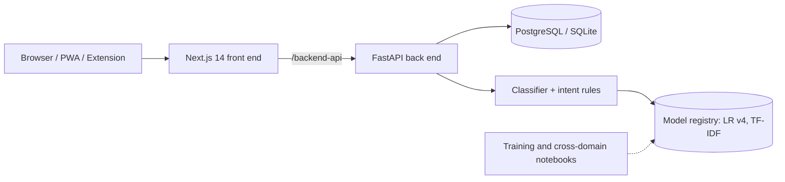

<div align="center">

# ScamGuard

### AI-Based Online Scam and Fraud Detection System

Detects scams in SMS, WhatsApp text, links, emails, screenshots, PDFs, QR codes and calls, and explains every verdict.

[](https://scamguard-frontend-r6t7.onrender.com)
[](backend/ml_training/research/results.md)
[](backend/ml_training/research/results.md)
[](#tests)


**[Open the live site](https://scamguard-frontend-r6t7.onrender.com)** · paste a message into the quick check, or press **Try the demo account** on the sign-in page.

</div>

<p align="center">
  
  
</p>

## Project documents

Major Project Phase-2, Department of CSE, B.M.S. College of Engineering, Group 56.

| Document | File |
|---|---|
| Project report | [docs/report/ScamGuard_Project_Report.pdf](docs/report/ScamGuard_Project_Report.pdf) (LaTeX source in [docs/report](docs/report)) |
| Presentation | [docs/presentation/ScamGuard_Final_Presentation.pptx](docs/presentation/ScamGuard_Final_Presentation.pptx) |
| Poster (A3) | [docs/poster/ScamGuard_Poster_A3.pdf](docs/poster/ScamGuard_Poster_A3.pdf) |
| Conference paper (COMP-SIF 2027, Paper ID 1206) | [docs/paper/ScamGuard_Conference_Paper.pdf](docs/paper/ScamGuard_Conference_Paper.pdf) |
| Cross-domain study (notebook and Streamlit app) | [research/cross_domain](research/cross_domain) |

## Results

Deployed system (classifier + intent rules) on **1,874 real Indian messages from scam campaigns held out of training**:

| Accuracy | Precision | Recall | F1 (95% CI) | False-alarm rate | ROC-AUC |
|:---:|:---:|:---:|:---:|:---:|:---:|
| **97.1%** | **98.2%** | **97.2%** | **97.7%** (97.1–98.3) | **3.2%** | **0.995** |

- **Dataset:** ScamGuard-IN-2026, 11,399 Indian messages with audited labels ([datasheet](backend/ml_training/datasets/scamguard_in_2026/DATASHEET.md)).
- **No leakage:** the split is by scam campaign, so no near-duplicate of a test message appears in training.
- **Reproducible:** `python -m ml_training.research.run_experiments` (from `backend/`) regenerates every number; tables are in [results.md](backend/ml_training/research/results.md).

### Cross-domain study

| Logistic Regression | Spam F1 |
|---|:---:|
| Trained on UK SMS (UCI), tested on UK SMS | 0.911 |
| Same model tested on Indian SMS | 0.678 |
| After adding 143 labelled Indian messages (10%) | 0.964 |

The website's **Cross-domain study** page runs the baseline and adapted models side by side on any message.

<p align="center"></p>

## Features

**Check**
- **Quick check** on the home page, no account needed and nothing stored.
- **Investigate** for text, links, emails, screenshots (OCR), PDFs, QR codes and voice calls.

**Explain**
- **Scam X-Ray** highlights the trap phrases and maps them to the four stages of a scam: hook, pressure, the ask, cash-out.
- **TrustLens** shows the model probability and the final risk score side by side, with the evidence for and against.
- **Website trust score**: domain age, HTTPS, redirects and whether the page asks for passwords, OTPs or card details.
- **ScamGuard Copilot** answers "is this a scam?" and "I already paid, what now?", grounded in the scan and 42 known Indian scam patterns.

**Act**
- **Golden Hour** help for people who already paid: a one-hour countdown, a call to 1930 and a ready complaint.
- One-tap reporting to **Chakshu** (Sanchar Saathi), **1930** and **cybercrime.gov.in**.
- **Safety tools**: QR payment check, UPI "before you pay" check, payment screenshot check, file check and chat timeline.

**Track and learn**
- **Dashboard, History and Analytics** for signed-in users, with PDF and CSV reports.
- **Scam trends**, **Flashcards**, an installable app (PWA) and a **browser extension** for Chrome, Edge and Brave.

## Architecture



| Layer | Technology |
|---|---|
| Front end | Next.js 14, React, TypeScript, Tailwind CSS, PWA |
| Back end | Python, FastAPI, SQLAlchemy, Alembic, JWT with refresh rotation, rate limiting |
| ML | scikit-learn logistic regression on word + character TF-IDF, intent-based risk engine |
| Copilot | Google Gemini with built-in fallback answers |
| Inputs | OCR, PDF parsing, QR decoding, speech-to-text |
| Research | Jupyter notebook, Streamlit |

## Run it locally

Needs **Python 3.10–3.14** and **Node.js 18+**. No database, `.env` file or Docker is required.

```bash
python run.py      # Windows (or double-click start_all.bat)
python3 run.py     # macOS / Linux (or ./start.sh)
```

The first run installs everything (2–5 minutes), then opens http://localhost:3000. The API runs on http://127.0.0.1:8000 (docs at `/docs`). In VS Code, use **Terminal → Run Task → ScamGuard: Run (backend + frontend)**. See [START_HERE.md](START_HERE.md) for troubleshooting.

Optional full stack with PostgreSQL: `docker compose up --build`.

## Tests

```bash
cd backend && python -m pytest -q                              # 836 tests
cd frontend && npm run typecheck && npm run lint && npm test   # 14 tests
```

## Security and privacy

- bcrypt passwords, short-lived JWTs with refresh rotation, self-hosted CAPTCHA and rate limits.
- Links are opened only on the server, with SSRF protection; uploads are capped at 8 MB.
- Quick checks are never stored; saved scans are visible only to their owner, who can download or delete them.

## Repository structure

```
backend/
  app_service/    FastAPI app: API routes, services, database
  ml_common/      shared preprocessing, features, model registry
  ml_training/    training pipeline, ScamGuard-IN-2026 dataset, experiments
  ml_service/     optional separate inference service
  artifacts/      trained models
  tests/          back-end tests
frontend/         Next.js app
browser-extension/
research/cross_domain/   cross-domain notebook, data, outputs, Streamlit app
docs/             report, presentation, poster, paper, screenshots
infra/            Dockerfiles and nginx config
run.py            one-command local run
```

## Team

| | |
|---|---|
| Author | **Priyam Thakur** (1BM23CS252) · [@priyamthakur275](https://github.com/priyamthakur275) |
| Team | Bhavya Goyal (1BM23CS063), Samir Chaudhary (1BM23CS294), Sana Subodh (1BM23CS296) |
| Guide | Dr. Kayarvizhy N, Professor, Department of CSE, B.M.S. College of Engineering, Bengaluru |
